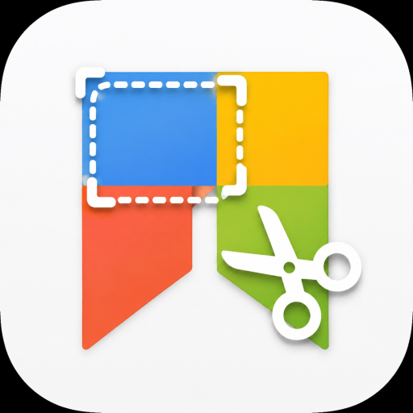

<div align="center">



# jietuyao <sub style="font-size:16px;color:#D97757">截图耀</sub>

**截图 · 贴图 · GIF · 长截图 · 剪贴板 · 翻译 / OCR / AI** —— 一体化桌面工具

C# WPF · .NET 10 · Windows

<a href="https://dotnet.microsoft.com/"></a>
<a href="#工程质量"></a>
<a href="LICENSE"></a>
<a href="#插件生态"></a>


</div>

---

> 一切你顺手的方式：**按下 `Alt+X`，框住屏幕，标注，回车。**
> 一次按键进入完整工作流 —— 截图、贴在桌面上、录成 GIF、拼成长图、送进 AI。

## 六件套

| | 模块 | 能力 |
|---|---|---|
| 📸 | **截图** | 多屏冻结 · 智能窗口吸附 · 放大镜取色 · **10 种标注工具** · 图元移动/缩放/旋转 · 圆角截图 · 描边/阴影 · 锁定比例 · 刷新背景 |
| 📌 | **贴图** | 置顶钉图 · 滚轮缩放 · 透明度 · 缩略图 · 再次编辑 · **OCR 文字层**（点选/拖框复制） |
| 🎬 | **GIF** | 区域录制 5–24fps · 暂停续录 · **录制中手绘标注**（按时间线分段生效） · **鼠标点击烟花 / 滚轮箭头特效** · 回放裁剪 |
| 📜 | **长截图** | 滚轮自动连拍 · 行哈希最优重叠拼接 · 方向切换 · 顶部忽略 |
| 📋 | **剪贴板** | SQLite 历史 · 搜索/筛选 · 分组 · **13 种特殊粘贴**（SQL IN / JSON / 加行号…） · 自动粘贴 · CSV 导入导出 |
| 🌐 | **翻译 / OCR / AI** | 谷歌 · 微软 · DeepL · 百度 · Azure · Amazon · **智谱 GLM** · **任意 OpenAI 兼容端点**（DeepSeek / Ollama / 自建） · **本地 PP-OCR 完全离线** · Edge TTS |

## 快捷键

一切从 `Alt + X` 开始。

| 键 | 动作 | | 键 | 动作（截图编辑器内） |
|---|---|---|---|---|
| <kbd>Alt</kbd>+<kbd>X</kbd> | 截图 | | <kbd>1</kbd>–<kbd>0</kbd> | 切换 10 种工具 |
| <kbd>Ctrl</kbd>+<kbd>Alt</kbd>+<kbd>V</kbd> | 剪贴板历史 | | <kbd>Enter</kbd> / <kbd>C</kbd> | 复制 |
| <kbd>Alt</kbd>+<kbd>D</kbd> | 划词翻译 | | <kbd>T</kbd> | 贴图 |
| <kbd>Alt</kbd>+<kbd>S</kbd> | 截图翻译 | | <kbd>L</kbd> | 长截图 |
| <kbd>Alt</kbd>+<kbd>Shift</kbd>+<kbd>X</kbd> | 图片翻译 | | <kbd>G</kbd> | GIF 录屏 |
| <kbd>Alt</kbd>+<kbd>Shift</kbd>+<kbd>S</kbd> | OCR | | <kbd>O</kbd> / <kbd>F</kbd> | OCR / 翻译 |
| | | | <kbd>Ctrl</kbd>+<kbd>Z</kbd>/<kbd>Y</kbd> | 撤销 / 重做 |

全部快捷键可在 **设置 → 快捷键** 中修改（含冲突检测与全屏应用忽略）。

## 快速开始

```
1. dotnet build src/jietuyao.slnx -c Release      # 需 .NET 10 SDK
2. 运行 src/.artifacts/Release/jietuyao.exe
3. 按 Alt+X 开始
```

<details>
<summary><b>可选配置</b></summary>

- **本地离线 OCR**：PaddleOCR 导出的 `PP-OCRv6_det_small.onnx / PP-OCRv6_rec_small.onnx` 放到 exe 同级 `models/` 目录，设置 → OCR 启用 *PP-OCR (Local)*
- **连接 AI**：设置 → 翻译 → 启用 *OpenAI* → 填任意兼容端点（GLM `https://open.bigmodel.cn/` · DeepSeek · Ollama `http://localhost:11434/` · 自建）+ Key
- **插件市场**：设置 → 插件，在线安装/升级官方插件

</details>

## 插件生态

内置 **24 个插件**：12 翻译（含 Azure / Amazon / 智谱 / OpenAI 兼容）· 8 OCR（含本地 PP-OCR）· TTS · 生词本，支持插件市场在线扩展、多实例并存、自定义提示词（翻译 / 润色 / 总结）。

## 工程质量

- **576 项自动化测试**全绿 —— 含引擎**真实执行**测试（拼接/GIF/PDF/WEBP/CSV 端到端）与 **PP-OCR 真模型推理**
- 性能基准固化进测试：取色 150ns/次 · JPEG 0.5ms/帧 · 1080p 冻结转源 42ms
- 启动即用：`Release` 冷启动 ~3.4s / ~195MB（原 Python 版同机 90s 未完成加载）

## 文档

- [功能迁移总台账](docs/feature-parity.md) —— v1 → v2 逐项对照与验证证据
- [截图编辑器设计](docs/M1-screenshot-editor.md)

---

<div align="center">

**jietuyao 截图耀** · MIT

截图不是功能，是呼吸。

</div>
